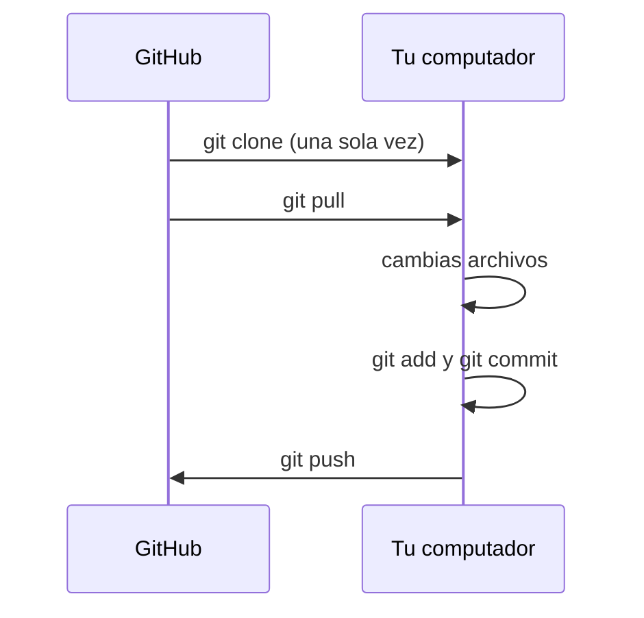

En [De tu computador a GitHub](/ramos/programacion-avanzada/construyendo-un-blockbuster/de-tu-computador-a-github.md) el proyecto nació en tu equipo y lo subiste. En el trabajo real casi siempre es al revés: el proyecto ya existe, alguien lo empezó, y tú llegas a sumarte. Eso es **clonar**.

Los ejemplos usan `blockbuster`, el proyecto del ramo. Sirven igual para cualquier repositorio: cambia el usuario y el nombre.

## El ciclo completo

Trabajar sobre un repositorio compartido es repetir siempre lo mismo:



Clonar se hace una vez. Lo demás es la rutina de todos los días: traer lo nuevo, cambiar, guardar y subir.

## 1. Clonar

En la página del repositorio en GitHub, el botón verde **Code** muestra la dirección. Elige **SSH** y cópiala.

```bash
cd ~/Lerd
git clone git@github.com:USUARIO/blockbuster.git
cd blockbuster
```

`git clone` crea la carpeta `blockbuster`, descarga los archivos **y también todo el historial**. No hace falta `git init` ni `git remote add`: el repositorio ya viene enlazado con GitHub.

Compruébalo:

```bash
git log --oneline
git remote -v
```

El primero muestra los commits que hicieron otras personas antes que tú. El segundo, la dirección de donde vino.

Desde PhpStorm se hace con **Clone Repository** en la pantalla de bienvenida, o con **Git → Clone** en el menú principal. Pegas la dirección, eliges la carpeta (que sea dentro de `~/Lerd`) y presionas **Clone**.

## 2. Hacer que funcione

Si abres `http://blockbuster.test` justo después de clonar, vas a ver un error. No hiciste nada mal: al proyecto le falta todo lo que [no se sube a GitHub](/ramos/programacion-avanzada/construyendo-un-blockbuster/de-tu-computador-a-github.md#lo-que-no-se-sube).

| Falta | Por qué | Se arregla con |
|---|---|---|
| `vendor/` | Las dependencias no viajan en el repositorio | `composer install` |
| `.env` | La configuración es de cada computador | copiar `.env.example` |
| La clave de la aplicación | Vive dentro del `.env` | `php artisan key:generate` |
| La base de datos | Cada quien tiene la suya | `php artisan migrate` |

### Con Lerd, un comando

```bash
lerd setup
```

Muestra una lista de pasos, con los necesarios ya marcados: instalar dependencias, preparar el `.env`, correr las migraciones y abrir el sitio. Acepta con `Enter` y espera a que termine.

### A mano, para entender qué pasó

Son los mismos pasos, uno por uno:

```bash
composer install
cp .env.example .env
php artisan key:generate
php artisan migrate
```

1. `composer install` lee `composer.lock` y descarga **exactamente las mismas versiones** de las bibliotecas que usa el resto del equipo.
2. `cp` crea tu `.env` a partir de la plantilla que sí viene en el repositorio.
3. `key:generate` escribe en el `.env` una clave única, que Laravel usa para cifrar.
4. `migrate` crea las tablas. Si la base de datos SQLite no existe, pregunta si quieres crearla: responde que sí.

Ahora `http://blockbuster.test` debería mostrar la aplicación.



## 3. Tener permiso para subir

Clonar un repositorio público lo puede hacer cualquiera. Subir cambios, no: solo quienes tengan permiso de escritura.

Quien es dueño del repositorio te agrega en *Settings → Collaborators → Add people*. Te llega una invitación por correo, y hay que **aceptarla**. Hasta entonces, `git push` va a fallar con un error de permisos.

## 4. Hacer un cambio

Antes de tocar nada, trae lo último:

```bash
git pull
```

Ahora un cambio chico y fácil de comprobar. Abre `routes/web.php` y agrega una ruta al final:

```php
Route::get('/hola', function () {
    return 'Hola desde Blockbuster';
});
```

Visita `http://blockbuster.test/hola`. Si ves el saludo, el cambio funciona.

### Mirar antes de guardar

```bash
git status
git diff
```

`git status` dice **qué archivos** cambiaron. `git diff` muestra **qué cambió dentro**: en verde las líneas que agregaste, en rojo las que quitaste. Se sale con la tecla `q`.

Acostúmbrate a mirar el `diff` antes de cada commit. Es la forma de no subir por accidente una prueba a medias, un `dd()` olvidado o un archivo que no tenía nada que ver.

## 5. Commit

```bash
git add routes/web.php
git commit -m "Agrega ruta de saludo"
```

Esta vez `git add` lleva el nombre del archivo en vez del punto. Así eliges con precisión qué entra en el commit, y lo demás queda esperando.

### Un buen mensaje

El mensaje es para quien lea el historial dentro de seis meses, que probablemente seas tú.

| Así no | Así sí |
|---|---|
| `cambios` | `Agrega ruta de saludo` |
| `arreglo` | `Corrige el cálculo de la multa por atraso` |
| `asdf` | `Valida que el socio esté activo antes de arrendar` |

Una línea corta que diga **qué hace** el commit. Si para describirlo necesitas escribir "y", probablemente eran dos commits.

## 6. Push

```bash
git push
```

Recarga el repositorio en GitHub: ahí está tu commit, con tu nombre.

### Si te lo rechaza

```plaintext
! [rejected]        main -> main (fetch first)
```

Significa que alguien subió cambios después de tu último `git pull`. GitHub tiene commits que tú no, y Git no te deja pasar por encima de ellos. La solución es traerlos y volver a intentar:

```bash
git pull --rebase
git push
```

Un `git pull` a secas aquí se niega a seguir, porque tú y GitHub tienen commits distintos y Git no sabe cómo quieres juntarlos. Con `--rebase` se lo dices: primero los commits que venían de GitHub, y los tuyos a continuación.

Si la otra persona tocó archivos distintos, Git junta los dos trabajos solo. Si tocaron **las mismas líneas**, aparece un **conflicto**: Git no puede decidir cuál versión vale y te pide que elijas. Eso lo vamos a ver más adelante.

## Lo mismo, desde PhpStorm

Todo lo anterior tiene su botón, y vale la pena usarlo una vez que entiendes qué hay debajo:

| Acción | Dónde | Atajo |
|---|---|---|
| Traer cambios (`pull`) | **Git → Update Project** | `Ctrl+T` |
| Ver qué cambió | Panel **Commit**, a la izquierda | `Alt+0` |
| Commit | Marcas los archivos, escribes el mensaje y presionas **Commit** | `Ctrl+K` |
| Commit y push juntos | Botón **Commit and Push** | `Ctrl+Alt+K` |
| Subir (`push`) | **Git → Push** | `Ctrl+Shift+K` |

En el panel **Commit**, doble clic sobre un archivo abre el `diff` lado a lado: la versión anterior a la izquierda y la tuya a la derecha. Es bastante más cómodo que el de la terminal.

## En resumen

| Comando | Qué hace |
|---|---|
| `git clone <dirección>` | Descarga un repositorio con todo su historial |
| `git pull` | Trae los cambios nuevos desde GitHub |
| `git pull --rebase` | Lo mismo, cuando además tienes commits propios sin subir |
| `git status` | Muestra qué archivos cambiaron |
| `git diff` | Muestra qué cambió dentro de los archivos |
| `git add <archivo>` | Prepara un archivo para el commit |
| `git commit -m "mensaje"` | Guarda los cambios preparados en el historial |
| `git push` | Sube tus commits a GitHub |

La rutina diaria cabe en una línea: **pull, cambiar, revisar, commit, push.**
