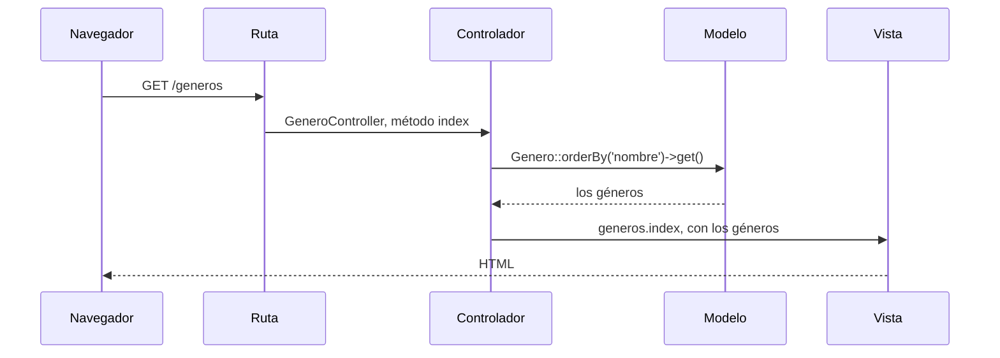

El videoclub ya tiene datos: películas, géneros, clasificaciones, copias y socios. Pero solo se pueden ver en Tinker o como JSON. Ahora toca que alguien parado en el mostrador pueda **verlos en una página**.

Este trabajo no viene repartido. Son seis pantallas y un equipo: cómo se organizan es parte de la tarea. Las reglas para trabajar varias personas sobre lo mismo están en [Trabajar en equipo sobre el mismo código](/ramos/programacion-avanzada/construyendo-un-blockbuster/trabajar-en-equipo.md). Léela antes de escribir la primera línea.

## Cómo llega una página al navegador

Cuando alguien abre `http://blockbuster-grupo.test/generos`, pasan tres cosas, cada una en su archivo:



| Pieza | Archivo | Qué decide |
|---|---|---|
| [Ruta](https://laravel.com/docs/13.x/routing) | `routes/web.php` | Qué dirección lleva a qué código |
| [Controlador](https://laravel.com/docs/13.x/controllers) | `app/Http/Controllers/` | Qué datos se necesitan |
| [Vista](https://laravel.com/docs/13.x/blade) | `resources/views/` | Cómo se muestran |

Ninguna hace el trabajo de la otra: la vista no consulta la base de datos, y el controlador no escribe HTML.

## Un ejemplo completo: la lista de géneros

Esta pantalla no es una de las seis. Sirve de modelo, y **es lo primero que el equipo sube**, porque trae la plantilla que van a usar todas las demás.

### 1. La plantilla común

Todas las páginas comparten el encabezado y el menú. Eso se escribe una sola vez, en `resources/views/layouts/app.blade.php`:


```html
<!DOCTYPE html>
<html lang="es">
<head>
    <meta charset="utf-8">
    <meta name="viewport" content="width=device-width, initial-scale=1">
    <title>@yield('titulo') · Blockbuster</title>
    <link rel="stylesheet" href="https://cdn.jsdelivr.net/npm/@picocss/pico@2/css/pico.min.css">
</head>
<body>
    <header class="container">
        <nav>
            <ul>
                <li><strong>Blockbuster</strong></li>
            </ul>
            <ul>
                <li><a href="{{ url('/generos') }}">Géneros</a></li>
            </ul>
        </nav>
    </header>

    <main class="container">
        <h1>@yield('titulo')</h1>

        @yield('contenido')
    </main>
</body>
</html>
```


Cada `@yield` es un hueco que llena la página que use esta plantilla. La hoja de estilos es [Pico](https://picocss.com): le da un aspecto decente al HTML sin que tengas que escribir clases ni instalar nada.

### 2. El controlador

```bash
php artisan make:controller GeneroController
```

En `app/Http/Controllers/GeneroController.php`:

```PHP
<?php

namespace App\Http\Controllers;

use App\Models\Genero;
use Illuminate\View\View;

class GeneroController extends Controller
{
    public function index(): View
    {
        $generos = Genero::withCount('peliculas')->orderBy('nombre')->get();

        return view('generos.index', ['generos' => $generos]);
    }
}
```

`withCount('peliculas')` le agrega a cada género un dato `peliculas_count`, con una sola consulta. `view('generos.index', ...)` busca el archivo `resources/views/generos/index.blade.php` y le entrega la variable `$generos`.

### 3. La ruta

En `routes/web.php`:

```PHP
use App\Http\Controllers\GeneroController;

Route::get('/generos', [GeneroController::class, 'index'])->name('generos.index');
```

El `name` es un apodo para la ruta. Sirve para escribir enlaces sin copiar la dirección a mano.

### 4. La vista

En `resources/views/generos/index.blade.php`:


```html
@extends('layouts.app')

@section('titulo', 'Géneros')

@section('contenido')
    <table>
        <thead>
            <tr>
                <th>Género</th>
                <th>Descripción</th>
                <th>Películas</th>
            </tr>
        </thead>
        <tbody>
            @forelse ($generos as $genero)
                <tr>
                    <td>{{ $genero->nombre }}</td>
                    <td>{{ $genero->descripcion }}</td>
                    <td>{{ $genero->peliculas_count }}</td>
                </tr>
            @empty
                <tr>
                    <td colspan="3">No hay géneros cargados.</td>
                </tr>
            @endforelse
        </tbody>
    </table>
@endsection
```


Lo que hay que saber de [Blade](https://laravel.com/docs/13.x/blade):


- **`{{ ... }}`** muestra un valor. Siempre así, nunca con `echo`: las llaves dobles protegen la página si el dato trae HTML malicioso.
- **`@forelse ... @empty ... @endforelse`** recorre una lista y tiene un plan para cuando viene vacía. También existen `@foreach` y `@if`.
- **`@extends`** y **`@section`** llenan los huecos de la plantilla.


Abre `http://blockbuster-grupo.test/generos`. Si ves la tabla, ya tienes el patrón completo.

## Las seis pantallas

| Pantalla | Dirección | Nombre de la ruta |
|---|---|---|
| Listado de películas | `/peliculas` | `peliculas.index` |
| Detalle de película | `/peliculas/{pelicula}` | `peliculas.show` |
| Listado de socios | `/socios` | `socios.index` |
| Detalle de socio | `/socios/{socio}` | `socios.show` |
| Copias, por película, formato y estado | `/copias` | `copias.index` |
| Películas por género | `/generos/{genero}` | `generos.show` |

Hoy `/peliculas` y `/socios` devuelven JSON desde `routes/web.php`. Esas dos rutas se reemplazan por las nuevas.

### Listado de películas

- Una tabla ordenada por título con título, año, género, clasificación y duración.
- El título es un enlace al detalle de la película. El género, un enlace a las películas de ese género.
- Una película puede no tener clasificación: la página no se puede caer por eso.

### Detalle de película

- Todos los datos: título, año, director, reparto, duración, sinopsis, género y clasificación.
- Cuántas copias tiene y cuántas están disponibles.
- Un enlace a la lista de copias, ya filtrada por esta película.

### Listado de socios

- Nombre, RUT, edad y estado. La edad no está en la tabla: la calcula el modelo.
- Los socios suspendidos tienen que distinguirse a simple vista.
- El nombre es un enlace al detalle.

### Detalle de socio

- Todos sus datos, incluida la fecha de nacimiento con formato de fecha chilena (`d/m/Y`).
- Un socio puede no tener teléfono: se muestra un texto como «Sin teléfono», no un espacio vacío.

### Copias

- Una tabla con código, película, formato y estado.
- Arriba, un formulario con tres filtros: película, formato y estado. Se pueden combinar, y sin filtros se ven todas.
- El nombre de la película enlaza a su detalle.

### Películas por género

- El nombre y la descripción del género, y la lista de sus películas, cada una con enlace a su detalle.
- En la lista de géneros del ejemplo, el nombre de cada género pasa a ser un enlace a esta pantalla.

## Lo que vas a necesitar

### Una dirección con un dato adentro

El `{pelicula}` de la ruta es un hueco. Si el parámetro del método se llama igual y tiene el modelo como tipo, Laravel busca la película por su `id` y te la entrega lista. Si no existe, responde con un error 404 sin que escribas nada. Se llama [enlace de modelos a rutas](https://laravel.com/docs/13.x/routing#route-model-binding).

```PHP
Route::get('/peliculas/{pelicula}', [PeliculaController::class, 'show'])->name('peliculas.show');
```

```PHP
public function show(Pelicula $pelicula): View
{
    return view('peliculas.show', ['pelicula' => $pelicula]);
}
```

### Enlaces

Con el nombre de la ruta, y el modelo como dato:


```html
<a href="{{ route('peliculas.show', $pelicula) }}">{{ $pelicula->titulo }}</a>
```


Y agrega cada listado nuevo al menú de la plantilla.

### Traer las relaciones de una vez

Si la tabla de películas muestra el género de cada una, y lo pides dentro del ciclo, Laravel hace una consulta por cada fila. Con 16 películas son 17 consultas. Pídelas juntas en el controlador, con [`with`](https://laravel.com/docs/13.x/eloquent-relationships#eager-loading):

```PHP
$peliculas = Pelicula::with(['genero', 'clasificacion'])->orderBy('titulo')->get();
```

### Cuando un dato puede faltar


```html
{{ $pelicula->clasificacion?->codigo ?? 'Sin clasificar' }}
{{ $socio->telefono ?? 'Sin teléfono' }}
{{ $socio->fecha_nacimiento->format('d/m/Y') }}
```


`?->` evita el error si no hay clasificación, y `??` pone un texto en su lugar.

### Filtros

Un formulario con `method="get"` manda sus campos en la dirección: `/copias?formato=DVD&estado=disponible`. El controlador los lee del [`Request`](https://laravel.com/docs/13.x/requests) y aplica cada filtro solo si viene con algo:

```PHP
public function index(Request $request): View
{
    $copias = Copia::with('pelicula')
        ->when($request->query('formato'), fn ($consulta, $formato) => $consulta->where('formato', $formato))
        ->orderBy('codigo')
        ->get();

    return view('copias.index', ['copias' => $copias]);
}
```

[`when`](https://laravel.com/docs/13.x/queries#conditional-clauses) agrega la condición únicamente si el primer valor no está vacío. Los otros dos filtros siguen la misma idea. Para el `<select>` de películas, el controlador tiene que mandar también la lista de películas a la vista.

## Cómo organizarse

No hay una pantalla por persona. Lo que sí hay son condiciones:

- **Primero, la base.** La plantilla y la lista de géneros van en una sola rama, que entra a `main` antes que cualquier pantalla. Si cada quien crea su propia plantilla, después no calza nada.
- **Una rama por pantalla**, con un nombre que diga qué es: `peliculas-listado`, `socio-detalle`.
- **Nadie trabaja solo.** Cada rama tiene commits de al menos dos personas: quien arma la pantalla, y quien la revisa y **sube sus correcciones a esa misma rama**. Comentar no cuenta: hay que hacer commit.
- **Todos pasan por todos los roles.** Cada integrante arma al menos una pantalla y corrige al menos otra.
- **Se anota quién hace qué.** En la pestaña **Issues** del repositorio, una tarea por pantalla, asignada a quien la arma y a quien la corrige. Así nadie parte lo que otra persona ya empezó.
- **Los pull requests los fusiona la PM**, igual que antes.

Las seis pantallas tocan dos archivos en común: `routes/web.php` y el menú de la plantilla. **Van a aparecer conflictos.** No es una falla de coordinación: es lo normal cuando un equipo avanza a la vez, y resolverlos es parte de este trabajo. Cómo hacerlo está en [Trabajar en equipo sobre el mismo código](/ramos/programacion-avanzada/construyendo-un-blockbuster/trabajar-en-equipo.md#a_4-resolver-un-conflicto-en-phpstorm).

## Antes de pedir la revisión

1. La pantalla se abre sin errores con los datos de `php artisan migrate:fresh --seed`.
2. Los enlaces llevan a donde dicen, y el menú incluye la pantalla si es un listado.
3. Abriste una dirección que no existe, como `/peliculas/9999`, y responde 404 en vez de un error.
4. La vista no hace consultas: todo lo que muestra se lo entregó el controlador.
5. La rama tiene lo último de `main` y no trae archivos ajenos al proyecto.
6. El pull request dice qué pantalla es, cómo probarla y quiénes trabajaron en ella.

---

Sigue con **[Trabajar en equipo sobre el mismo código](/ramos/programacion-avanzada/construyendo-un-blockbuster/trabajar-en-equipo.md)**.
